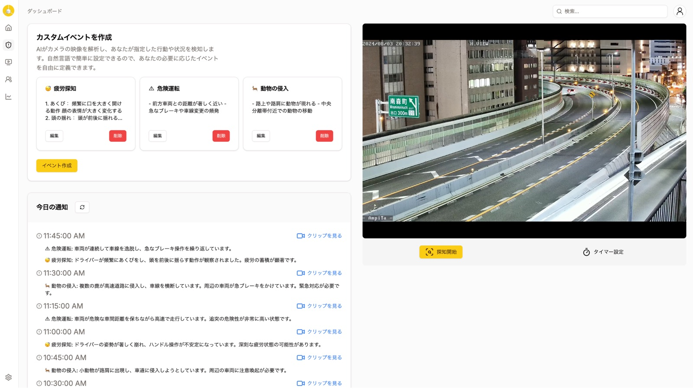
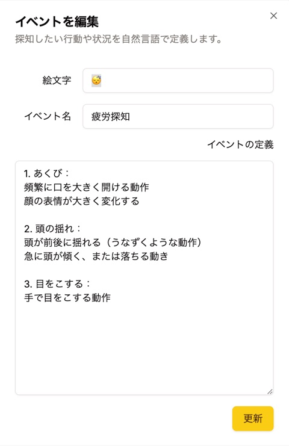
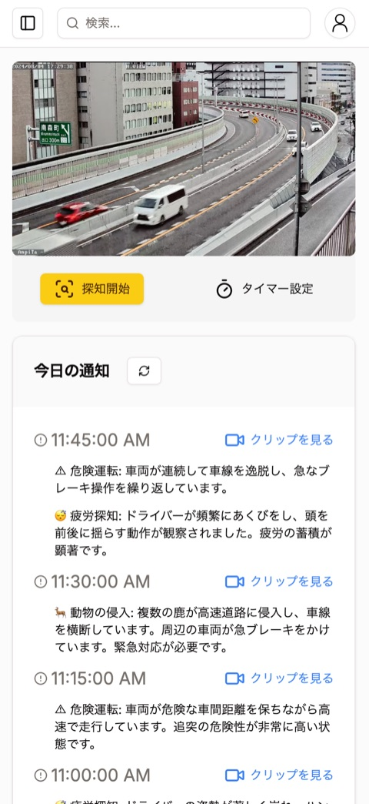
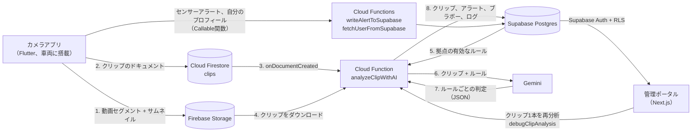

<p align="right"><a href="README.md">English</a> | <b>日本語</b></p>

# Tricubic Vision

[](https://github.com/weichaist/tricubic-vision/actions/workflows/ci.yml)
[](LICENSE)


**AIに言葉で指示、瞬時に通知。**

倉庫のフォークリフトなどの車両向けAI安全カメラです。

車両に取り付けたスマートフォンが走行の様子を1分単位のセグメントで録画し、クリップを1本ずつアップロードします。Cloud Functionは、そのクリップを拠点の安全ルール（自然言語で記述）と一緒にGeminiへ送ります。Geminiはルールごとに判定を返します。違反は**アラート**に、守られたルールは**ブラボー**（UI上の名称）になります。管理者はWebポータルで両方を確認し、結果ごとに ⭕ / 🔼 / ❌ で評価します。これで、モデルの判定がどのくらい正しいかを把握できます。

スマートフォンのモーションセンサーは、モデルを使わない2つ目のシグナルになります。設定した加速度を超える急発進・急停止・急旋回があると、すぐにアラートを出します。

カメラアプリ・管理ポータルとも、UIは日本語です。

<p align="center">
  
</p>
<table align="center">
  <tr>
    <td align="center" width="50%"><br><sub>探知したい行動や状況を自然言語で定義。学習は不要</sub></td>
    <td align="center" width="50%"><br><sub>クリップへのリンク付きで通知</sub></td>
  </tr>
</table>

<sub>スクリーンショットは、同じ考え方で作られたホスト型の製品 Tricubic AI のWebダッシュボード（<a href="https://vision.tricubic.dev/">vision.tricubic.dev</a>）のものです。このリポジトリの管理ポータルは、拠点・ルール・拠点ごとのアラート一覧を中心に構成されているため、画面の見た目は異なります。</sub>

## 主な機能

- **自然言語で書く安全ルール**。拠点ごと、または全社共通で設定できます。モデルの学習やラベル付きデータは不要です。
- **スマートフォンがカメラになります。** 1分単位のセグメントを音声付きで録画し、サムネイルと一緒にバックグラウンドでアップロードしたあと、端末内のコピーを削除します。
- **Geminiがクリップをルールごとに判定します。** 破られたルールはアラートに、守られたルールはブラボーになります。
- **モーションセンサーによるアラート**。急発進・急停止・急旋回を、モデルを使わずにスマートフォン上で検知します。
- **管理ポータル**：拠点・アカウント・ルールを管理できます。拠点ごとのアラート・ブラボー・分析ログを日付とルールで絞り込んで表示し、CSVに書き出せます。
- **人によるフィードバック**：スタッフがすべての結果を ⭕ / 🔼 / ❌ で評価するので、モデルの正解率を測れます。
- **クリップ1本だけを再分析**：ログから実行して、モデルの生の回答を確認できます。

## 仕組み



1. **カメラアプリ**はスマートフォンのカメラで録画し（HD、音声付き）、60秒ごとに新しいセグメントに切り替えます。録画が終わったセグメントはサムネイルと一緒にFirebase Storageへアップロードされ、Firestoreの `clips` コレクションにドキュメントが追加されます。アップロード後、端末内のファイルは削除されます。
2. Firestoreへの書き込みをトリガーに **`analyzeClipWithAI`** が動きます。クリップをSupabaseに記録し、動画をダウンロードして、会社の有効なルール（クリップの拠点のルールと全社共通のルール）を読み込みます。次に動画をGemini Files APIへアップロードし、すべてのルールについてGeminiに判定させます。該当したルールは、それぞれアラート（違反）かブラボー（遵守）になります。実行内容は `logs` に記録されます。
3. 録画中、アプリは加速度センサーを監視します。しきい値（デフォルトは 12 m/s²、端末上で変更可能）を超えると、急発進・急停止・急旋回などのアラートを登録します。
4. **管理ポータル**では拠点・アカウント・ルールを管理し、拠点ごとのアラート・ブラボー・分析ログを日付とルールで絞り込んで表示できます。CSVへの書き出しにも対応しています。スタッフはアラートとブラボーを1件ずつ評価します（[評価システム](docs/evaluation-system.md)）。管理者はログの項目からクリップの分析を再実行し、Geminiの生の回答を確認できます。

詳しくは [docs/architecture.md](docs/architecture.md) を参照してください。

## リポジトリ構成

```
apps/camera/   Flutter製の録画アプリ（Android、iOS）
apps/admin/    Next.js製の管理ポータル
functions/     Firebase Cloud Functions：Geminiによるクリップ分析、Supabase用のヘルパー
supabase/      データベーススキーマ（migrations/）、ローカル設定、架空のシードデータ
docs/          アーキテクチャと評価システムのメモ
firebase.json  Firebaseプロジェクトの設定（Functions、FirestoreとStorageのルール、エミュレーター）
```

## 前提条件

- [Flutter](https://docs.flutter.dev/get-started/install) 3.47.9（`apps/camera/.fvmrc` で固定）。実機で動かすには Android Studio / Xcode も必要です
- Node.js 22（`functions/` と `apps/admin/` に `.nvmrc` があります）
- [Firebase CLI](https://firebase.google.com/docs/cli) と、**Blaze** プランのFirebaseプロジェクト（Cloud Functionsでシークレットと外部へのネットワークアクセスを使うため）
- [Supabase CLI](https://supabase.com/docs/guides/cli) とSupabaseプロジェクト（ローカル環境にはDockerが必要です）
- [Google AI Studio](https://aistudio.google.com/apikey) で取得したGemini APIキー

## セットアップ

### 1. Supabase

ホスト型プロジェクトの場合：

```bash
supabase link --project-ref <your-project-ref>
supabase db push            # supabase/migrations/ を適用
```

続いて、Supabaseダッシュボードで次の設定をします。

- **Authentication → Sign In / Providers**：*Allow new users to sign up* をオフにします。アカウントは管理者がポータルで作成します。また、Row Level Securityのポリシーはサインイン済みのユーザーをすべて信頼します。
- **Project Settings → API**：プロジェクトURL、anon（publishable）キー、service role（secret）キーを控えておきます。

ローカル環境の場合（他のSupabaseプロジェクトと衝突しないよう、ポートは57320〜57329を使います）：

```bash
supabase start              # API http://127.0.0.1:57321、Studio http://127.0.0.1:57323
supabase status             # ローカルのキーを表示
supabase db reset           # マイグレーションと supabase/seed.sql を再適用
```

シードデータとして、架空の会社1社、倉庫の拠点1か所、サンプルルール8件が追加されます。

**最初の管理者を作成します。** **Authentication → Users → Add user** でユーザーを追加し（*Auto Confirm User* にチェック）、そのユーザーIDをコピーしてから、SQLエディターで次を実行します。

```sql
insert into public.users (uid, company_uid, location_uid, email, first_name, last_name, role)
values (
  '<auth user id>',
  '00000000-0000-4000-8000-000000000001',  -- シードの会社、または自社のもの
  '00000000-0000-4000-8000-000000000011',  -- シードの拠点、または自社のもの
  'admin@example.com', '太郎', '管理', 'admin'
);
```

シードを使わないホスト型プロジェクトでは、先に会社を登録してください（ポータルには会社の画面がありません）：`insert into public.companies (name) values ('Your company');`。そのあと、ポータルかSQLで拠点を追加します。以降のアカウントはポータル（「アカウント管理」）で作成します。

### 2. Firebase

1. Firebaseプロジェクトを作成し、Blazeプランにアップグレードします。
2. **Authentication**（Email/Password）、**Cloud Firestore**、**Storage** を有効にします。
3. *Project settings → Your apps* で、必要なアプリを登録します。Androidアプリ（`dev.tricubic.vision`）、iOSアプリ（`dev.tricubic.vision`）、Webアプリ（管理ポータル用）です。
4. CLIで自分のプロジェクトを選択し、セキュリティルールをデプロイします。

```bash
firebase use --add          # または .firebaserc を編集
firebase deploy --only firestore:rules,storage
```

### 3. Cloud Functions

```bash
cd functions
npm ci
firebase functions:secrets:set SUPABASE_URL
firebase functions:secrets:set SUPABASE_SERVICE_ROLE_KEY
firebase functions:secrets:set GEMINI_API_KEY
cp .env.example .env        # 任意：GEMINI_MODEL を変更（デフォルトは gemini-2.5-pro）
firebase deploy --only functions
```

Functionsは `asia-northeast1` にデプロイされます（`functions/config.js` の `REGION`）。変更する場合は、カメラアプリと管理ポータルの設定にあるリージョンも合わせて変更してください。

エミュレーターを使う場合は、`.secret.local.example` を `.secret.local` にコピーして `npm run serve` を実行します。

### 4. 管理ポータル

```bash
cd apps/admin
npm ci
cp .env.example .env.local  # SupabaseとFirebase Webアプリの値を入力
npm run dev                 # http://localhost:3000
```

デプロイは一般的なNext.jsアプリと同じです（Vercelなど）。同じ環境変数を設定してください。詳しくは [apps/admin/README.md](apps/admin/README.md) を参照してください。

### 5. カメラアプリ

ドライバーは **Firebase Auth** でカメラアプリにサインインします。アプリは **メールアドレスをキーに**、Supabaseの `users` テーブルからプロフィールを探します。ドライバーごとに、次の作業をしてください。

1. ポータルでアカウントを作成します（ロールは「ユーザー」/ `appUser`）。これで、会社と拠点が設定された `users` の行が追加されます。
2. Firebaseコンソール → Authentication → Users で、同じメールアドレスを追加します。

そのあと、アプリを設定して実行します。

```bash
cd apps/camera
cp config/example.json config/dev.json   # Firebaseアプリの値を入力
flutter pub get
flutter run --dart-define-from-file=config/dev.json
```

詳しくは [apps/camera/README.md](apps/camera/README.md) を参照してください。

## 設定項目

| 場所 | 名前 | 内容 | 取得先 |
| --- | --- | --- | --- |
| `.firebaserc` | `projects.default` | FirebaseプロジェクトID | Firebaseコンソール |
| Functionsのシークレット | `SUPABASE_URL` | SupabaseプロジェクトのURL | Supabase → Project Settings → API |
| Functionsのシークレット | `SUPABASE_SERVICE_ROLE_KEY` | service role（secret）キー。RLSをバイパスします | Supabase → Project Settings → API |
| Functionsのシークレット | `GEMINI_API_KEY` | Gemini APIキー | Google AI Studio |
| `functions/.env` | `GEMINI_MODEL` | 分析に使うモデル（デフォルトは `gemini-2.5-pro`） | [Geminiのモデル一覧](https://ai.google.dev/gemini-api/docs/models) |
| `functions/config.js` | `REGION` | Functionsのリージョン（デフォルトは `asia-northeast1`） | 任意 |
| `apps/admin/.env.local` | `NEXT_PUBLIC_SUPABASE_URL` | SupabaseプロジェクトのURL | Supabase → Project Settings → API |
| `apps/admin/.env.local` | `NEXT_PUBLIC_SUPABASE_ANON_KEY` | anon（publishable）キー | Supabase → Project Settings → API |
| `apps/admin/.env.local` | `SUPABASE_SERVICE_ROLE_KEY` | サーバー専用。アカウントの作成に使います | Supabase → Project Settings → API |
| `apps/admin/.env.local` | `NEXT_PUBLIC_FIREBASE_API_KEY`, `_AUTH_DOMAIN`, `_PROJECT_ID`, `_STORAGE_BUCKET`, `_MESSAGING_SENDER_ID`, `_APP_ID` | Firebase Webアプリの設定（`debugClipAnalysis` の呼び出しに使います） | Firebase → Project settings → Your apps → Web |
| `apps/admin/.env.local` | `NEXT_PUBLIC_FIREBASE_FUNCTIONS_REGION` | Functionsのリージョン | `REGION` と同じ |
| `apps/camera/config/*.json` | `FIREBASE_PROJECT_ID`, `FIREBASE_MESSAGING_SENDER_ID`, `FIREBASE_STORAGE_BUCKET` | Firebaseプロジェクトの値 | Firebase → Project settings |
| `apps/camera/config/*.json` | `FIREBASE_ANDROID_API_KEY`, `FIREBASE_ANDROID_APP_ID` | Androidアプリの設定 | Firebase → Your apps → Android |
| `apps/camera/config/*.json` | `FIREBASE_IOS_API_KEY`, `FIREBASE_IOS_APP_ID`, `FIREBASE_IOS_BUNDLE_ID` | iOSアプリの設定 | Firebase → Your apps → iOS |
| `apps/camera/config/*.json` | `FIREBASE_FUNCTIONS_REGION` | Functionsのリージョン | `REGION` と同じ |
| `apps/camera/config/*.json` | `ACCELERATION_ALERT_RULE_UID` | センサーアラートを紐付けるルール（空欄なら紐付けなし） | `rules` の行の `uid` |

## 開発時のチェック

```bash
(cd apps/camera && flutter analyze && flutter test)
(cd functions && npm run lint)
(cd apps/admin && npm run lint && npm run typecheck && npm run build)
supabase db reset && supabase db lint
```

CIでも同じチェックを実行します（`.github/workflows/ci.yml`）。

## プロジェクトの状況

Tricubic Visionは、倉庫でのフォークリフトの安全対策のために2025年に開発され、2026年にオープンソース化されました。実際に使われていた状態のまま、依存関係を最新にして公開しています。既知の制限は次のとおりです。

- ドライバーには、同じメールアドレスのFirebase AuthアカウントとSupabaseの `users` 行の両方が必要です。Firebaseのアカウントは自動では作成されません。
- ポータルのRow Level Securityでは、サインイン済みのユーザーなら誰でも全データを閲覧でき、拠点とルールも編集できます。1つのプロジェクトで複数の組織を扱う前に、サインアップを無効にしたまま、ポリシーを厳しくしてください。
- 会社はSQLで作成します。ポータルで管理できるのは拠点・ルール・アカウントです。
- カメラアプリの登録リンクと更新ボタンはプレースホルダーです。また、ポータルのサイドバーにある「設定」セクションには、まだページがありません。
- `clips.length` に入っているのは再生時間ではなく、ファイルサイズ（バイト数）です。

## コントリビュート

[CONTRIBUTING.md](CONTRIBUTING.md) を参照してください。

## ライセンス

MIT — [LICENSE](LICENSE) を参照してください。Tricubic Visionの名称とTricubicのロゴは、このライセンスの対象外です。
