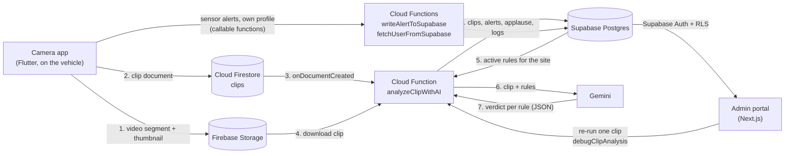

# Tricubic Vision

An AI safety camera for forklifts and other vehicles in warehouses.

A phone mounted on the vehicle records the drive in one-minute segments and
uploads each clip. A Cloud Function sends the clip to Gemini together with the
site's safety rules, written in plain language. Gemini answers rule by rule:
violations become **alerts**, rules that were followed become **applause**
("ブラボー" in the UI). Managers review both in a web portal and rate each result
⭕ / 🔼 / ❌, so you can see how often the model gets it right.

The phone's motion sensors add a second, model-free signal: a sudden start, stop
or turn above a set acceleration raises an alert immediately.

The user interface of both apps is in Japanese.

## How it works



1. The **camera app** records with the phone camera (HD, with sound) and cuts a
   new segment every 60 seconds. Each finished segment is uploaded to Firebase
   Storage with a thumbnail, and a document is added to the Firestore `clips`
   collection. The local file is deleted after the upload.
2. The Firestore write triggers **`analyzeClipWithAI`**. It records the clip in
   Supabase, downloads the video, loads the company's active rules (those for the
   clip's site plus company-wide ones), uploads the video to the Gemini Files API
   and asks Gemini to judge every rule. Each rule that applies becomes an alert
   (violated) or an applause (followed). The run is logged in `logs`.
3. While recording, the app watches the accelerometer. Above the threshold
   (default 12 m/s², adjustable on the device) it files an alert such as
   急発進 (sudden start), 急停止 (sudden stop) or 急旋回 (sudden turn).
4. The **admin portal** manages sites (拠点), accounts and rules, and shows
   alerts, applause and analysis logs per site, filtered by date and rule, with
   CSV export.
   Staff rate each alert and applause ([evaluation system](docs/evaluation-system.md)).
   From a log entry, admins can re-run the analysis of a clip to see Gemini's raw
   answer.

More detail: [docs/architecture.md](docs/architecture.md).

## Repository layout

```
apps/camera/   Flutter recorder app (Android, iOS)
apps/admin/    Next.js admin portal
functions/     Firebase Cloud Functions: clip analysis with Gemini, Supabase helpers
supabase/      Database schema (migrations/), local config, fictional seed data
docs/          Architecture and evaluation system notes
firebase.json  Firebase project config (functions, Firestore and Storage rules, emulators)
```

## Prerequisites

- [Flutter](https://docs.flutter.dev/get-started/install) 3.47.9 (pinned in
  `apps/camera/.fvmrc`), plus Android Studio / Xcode to run on a device
- Node.js 22 (`.nvmrc` in `functions/` and `apps/admin/`)
- [Firebase CLI](https://firebase.google.com/docs/cli) and a Firebase project on
  the **Blaze** plan (Cloud Functions with secrets and outbound network access)
- [Supabase CLI](https://supabase.com/docs/guides/cli) and a Supabase project
  (Docker for the local stack)
- A Gemini API key from [Google AI Studio](https://aistudio.google.com/apikey)

## Setup

### 1. Supabase

Hosted project:

```bash
supabase link --project-ref <your-project-ref>
supabase db push            # applies supabase/migrations/
```

Then, in the Supabase dashboard:

- **Authentication → Sign In / Providers**: turn off *Allow new users to sign up*.
  Accounts are created by admins in the portal, and the Row Level Security
  policies trust every signed-in user.
- **Project Settings → API**: note the project URL, the anon (publishable) key
  and the service role (secret) key.

Local stack (ports 57320-57329, so it does not collide with other Supabase
projects):

```bash
supabase start              # API http://127.0.0.1:57321, Studio http://127.0.0.1:57323
supabase status             # prints the local keys
supabase db reset           # re-applies migrations and supabase/seed.sql
```

The seed adds a fictional company, one warehouse site and eight sample rules.

**Create the first admin.** Add a user under **Authentication → Users → Add user**
(tick *Auto Confirm User*), copy its user id, then run in the SQL editor:

```sql
insert into public.users (uid, company_uid, location_uid, email, first_name, last_name, role)
values (
  '<auth user id>',
  '00000000-0000-4000-8000-000000000001',  -- seeded company, or your own
  '00000000-0000-4000-8000-000000000011',  -- seeded site, or your own
  'admin@example.com', '太郎', '管理', 'admin'
);
```

On a hosted project without the seed, insert a company first (the portal has no
company screen): `insert into public.companies (name) values ('Your company');`,
then add a site in the portal or with SQL. After that, create further accounts in
the portal (アカウント管理).

### 2. Firebase

1. Create a Firebase project and upgrade it to Blaze.
2. Enable **Authentication** (Email/Password), **Cloud Firestore** and **Storage**.
3. Register the apps you need under *Project settings → Your apps*: an Android app
   (`dev.tricubic.vision`), an iOS app (`dev.tricubic.vision`) and a Web app (for
   the admin portal).
4. Point the CLI at your project and deploy the security rules:

```bash
firebase use --add          # or edit .firebaserc
firebase deploy --only firestore:rules,storage
```

### 3. Cloud Functions

```bash
cd functions
npm ci
firebase functions:secrets:set SUPABASE_URL
firebase functions:secrets:set SUPABASE_SERVICE_ROLE_KEY
firebase functions:secrets:set GEMINI_API_KEY
cp .env.example .env        # optional: change GEMINI_MODEL (default gemini-2.5-pro)
firebase deploy --only functions
```

The functions are deployed to `asia-northeast1` (`REGION` in
`functions/config.js`). If you change it, change the region in the camera app and
admin portal config too.

For the emulator, copy `.secret.local.example` to `.secret.local` and run
`npm run serve`.

### 4. Admin portal

```bash
cd apps/admin
npm ci
cp .env.example .env.local  # fill in Supabase and Firebase web app values
npm run dev                 # http://localhost:3000
```

Deploy it like any Next.js app (for example on Vercel) with the same environment
variables. See [apps/admin/README.md](apps/admin/README.md).

### 5. Camera app

Drivers sign in to the camera app with **Firebase Auth**, and the app looks up
their profile in the Supabase `users` table **by email**. For each driver:

1. Create the account in the portal (role ユーザー / `appUser`), which adds the
   `users` row with their company and site.
2. Add the same email in Firebase console → Authentication → Users.

Then configure and run the app:

```bash
cd apps/camera
cp config/example.json config/dev.json   # fill in your Firebase app values
flutter pub get
flutter run --dart-define-from-file=config/dev.json
```

See [apps/camera/README.md](apps/camera/README.md).

## Configuration

| Where | Name | What it is | Where to get it |
| --- | --- | --- | --- |
| `.firebaserc` | `projects.default` | Firebase project id | Firebase console |
| Functions secret | `SUPABASE_URL` | Supabase project URL | Supabase → Project Settings → API |
| Functions secret | `SUPABASE_SERVICE_ROLE_KEY` | Service role (secret) key; bypasses RLS | Supabase → Project Settings → API |
| Functions secret | `GEMINI_API_KEY` | Gemini API key | Google AI Studio |
| `functions/.env` | `GEMINI_MODEL` | Model used for analysis (default `gemini-2.5-pro`) | [Gemini models](https://ai.google.dev/gemini-api/docs/models) |
| `functions/config.js` | `REGION` | Functions region (default `asia-northeast1`) | Your choice |
| `apps/admin/.env.local` | `NEXT_PUBLIC_SUPABASE_URL` | Supabase project URL | Supabase → Project Settings → API |
| `apps/admin/.env.local` | `NEXT_PUBLIC_SUPABASE_ANON_KEY` | Anon (publishable) key | Supabase → Project Settings → API |
| `apps/admin/.env.local` | `SUPABASE_SERVICE_ROLE_KEY` | Server-only; used to create accounts | Supabase → Project Settings → API |
| `apps/admin/.env.local` | `NEXT_PUBLIC_FIREBASE_API_KEY`, `_AUTH_DOMAIN`, `_PROJECT_ID`, `_STORAGE_BUCKET`, `_MESSAGING_SENDER_ID`, `_APP_ID` | Firebase Web app config (used to call `debugClipAnalysis`) | Firebase → Project settings → Your apps → Web |
| `apps/admin/.env.local` | `NEXT_PUBLIC_FIREBASE_FUNCTIONS_REGION` | Functions region | Same as `REGION` |
| `apps/camera/config/*.json` | `FIREBASE_PROJECT_ID`, `FIREBASE_MESSAGING_SENDER_ID`, `FIREBASE_STORAGE_BUCKET` | Firebase project values | Firebase → Project settings |
| `apps/camera/config/*.json` | `FIREBASE_ANDROID_API_KEY`, `FIREBASE_ANDROID_APP_ID` | Android app config | Firebase → Your apps → Android |
| `apps/camera/config/*.json` | `FIREBASE_IOS_API_KEY`, `FIREBASE_IOS_APP_ID`, `FIREBASE_IOS_BUNDLE_ID` | iOS app config | Firebase → Your apps → iOS |
| `apps/camera/config/*.json` | `FIREBASE_FUNCTIONS_REGION` | Functions region | Same as `REGION` |
| `apps/camera/config/*.json` | `ACCELERATION_ALERT_RULE_UID` | Rule that sensor alerts are filed under (empty = none) | `uid` of a row in `rules` |

## Development checks

```bash
(cd apps/camera && flutter analyze && flutter test)
(cd functions && npm run lint)
(cd apps/admin && npm run lint && npm run typecheck && npm run build)
supabase db reset && supabase db lint
```

CI runs the same checks (`.github/workflows/ci.yml`).

## Project status

Tricubic Vision was originally built in 2025 for forklift safety in warehouses and
open-sourced in 2026. It is published as it was used, upgraded to current
dependencies. Known gaps:

- Drivers need a Firebase Auth account and a Supabase `users` row with the same
  email; nothing creates the Firebase account for you.
- The portal's Row Level Security lets every signed-in user read all data and
  edit sites and rules. Keep sign-ups disabled and tighten the policies before
  hosting several organizations in one project.
- Companies are created with SQL; the portal manages sites, rules and accounts.
- The camera app's registration link and refresh button are placeholders, and
  the 設定 (settings) section in the portal sidebar has no pages yet.
- `clips.length` holds the file size in bytes, not the duration.

## Contributing

See [CONTRIBUTING.md](CONTRIBUTING.md).

## License

MIT — see [LICENSE](LICENSE). The Tricubic Vision name and the Tricubic logo
are not covered by the license.
