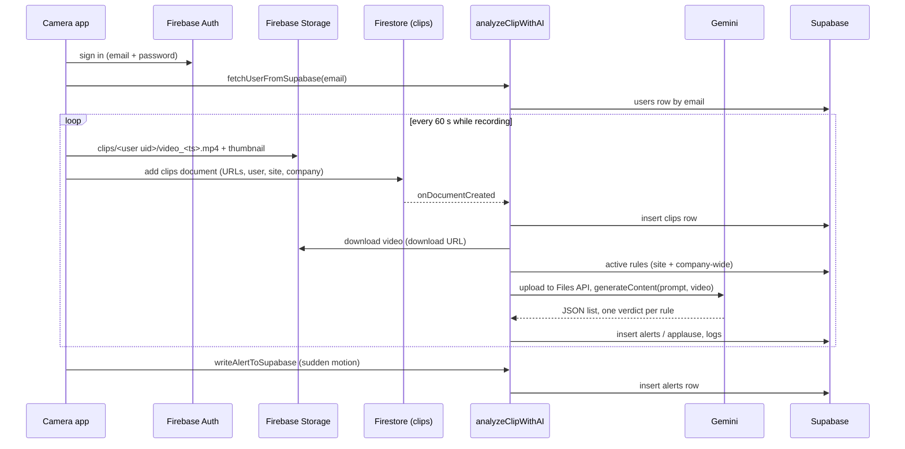

# Architecture

Tricubic Vision has three parts that share two backends:

- **Firebase** carries the video: Auth for drivers, Storage for clips and
  thumbnails, Firestore as the trigger, Cloud Functions for the analysis.
- **Supabase** holds everything people look at: companies, sites, users, rules,
  clips, alerts, applause, logs and evaluations. The admin portal signs in with
  Supabase Auth.

## Camera app (`apps/camera`)

Flutter, GetX for state and routing. Screens (Japanese UI):

| Route | Screen | What it does |
| --- | --- | --- |
| `/` | Root | Login screen or the home screen, depending on Firebase Auth |
| `/login` | ログイン | Email/password sign-in with Firebase Auth |
| `/monitor` | Home | Three tiles: start detection, profile, forward/backward test |
| `/permissions` | 必要な権限 | Requests camera, microphone and media permissions, then opens the camera |
| `/camera` | Recorder | camerawesome preview and recording, live acceleration readout |
| `/profile` | プロフィール | The Supabase `users` row (name, role, company, site) |
| `/walking-test` | Forward/backward test | Experimental: detects forward/backward movement from the accelerometer |

Controllers:

- `AuthController` keeps the Firebase user and loads the matching Supabase user
  through the `fetchUserFromSupabase` callable function.
- `BackgroundUploadController` queues finished segments, generates a thumbnail
  (`video_compress`), uploads both to Storage, writes the Firestore `clips`
  document and deletes the local file.
- `SensorController` reads the user accelerometer (gravity removed). When the
  magnitude crosses the threshold (default 12 m/s², stored in shared
  preferences; long-press the readout to change it) it classifies the motion by
  dominant axis and calls `writeAlertToSupabase`, at most once every 3 seconds.
- `WalkingDirectionController` powers the experimental forward/backward screen.

Recording: front camera by default (switchable), HD with audio, 3 Mbps on
Android. The page stops and restarts recording every 60 seconds. On Android,
segments are written to `Movies/TricubicVision/`; on iOS, to the app's documents
folder. The screen stays awake while recording (`wakelock_plus`).

Configuration is compiled in with `--dart-define-from-file`
(`lib/firebase_options.dart`, `lib/config/app_config.dart`).

## Cloud Functions (`functions`)

Node 22, firebase-functions v2 API, `@google/genai`. All functions run in
`asia-northeast1` (`config.js`).

| Function | Trigger | Caller check | Purpose |
| --- | --- | --- | --- |
| `analyzeClipWithAI` | Firestore `clips/{clipId}` created | n/a | Full analysis pipeline (below) |
| `writeAlertToSupabase` | Callable | Firebase Auth required | Insert a sensor alert |
| `fetchUserFromSupabase` | Callable | Firebase Auth; email must match the token | Return the caller's `users` row |
| `debugClipAnalysis` | Callable | Supabase access token of an admin or manager, same company | Re-run the analysis for one video URL and return Gemini's raw answer without writing results |

`analyzeClipWithAI`:

1. Skips clips without `video_url`, or with `length` under 100 (bytes).
2. Inserts the clip into Supabase `clips` (failures are logged, not fatal).
3. Downloads the video (30 s timeout, 100 MB limit).
4. Loads active rules: `company_uid` matches, and `location_uid` is the clip's
   site or null.
5. Uploads the video to the Gemini Files API, waits until it is processed, and
   calls `generateContent` with the prompt from `gemini.js`
   (`createSafetyAnalysisPrompt`) at temperature 0. The system instruction asks
   for Japanese answers. The uploaded file is deleted afterwards.
6. Parses the JSON array in the answer. For each rule with `rule_apply: true`,
   writes an alert (`alert: true`) or an applause (`alert: false`) with Gemini's
   explanation in `details`.
7. Writes a `logs` row with the status, duration, model and raw answer.

Secrets: `SUPABASE_URL`, `SUPABASE_SERVICE_ROLE_KEY`, `GEMINI_API_KEY`
(`defineSecret`). Parameter: `GEMINI_MODEL` (`defineString`, default
`gemini-2.5-pro`).

Maintenance scripts (not deployed): `npm run gemini-files:list` and
`npm run gemini-files:delete-all -- --yes` list or delete files left in the Gemini
Files API for a key.

## Admin portal (`apps/admin`)

Next.js 16 (App Router, Turbopack), Supabase SSR auth with cookies, shadcn/ui on
Tailwind CSS, TanStack Query.

- `proxy.ts` refreshes the Supabase session on every request and redirects
  signed-out visitors to `/sign-in`.
- `/dashboard`: sites and rules overview with alert/applause/log counts.
- `/dashboard/locations`, `/dashboard/locations/add`, `/dashboard/locations/[id]`:
  sites; the detail page has alert, applause and log tables with date and rule
  filters, pagination, CSV export and detail panels. Alert and applause panels
  carry the evaluation buttons; the alert panel also lists clips recorded within
  ±10 minutes of a sensor alert. Log panels can call `debugClipAnalysis`.
- `/dashboard/rules`, `/dashboard/rules/add`, `/dashboard/rules/[id]/edit`: rules
  (name, details, site or company-wide, active/inactive).
- `/dashboard/accounts`, `/dashboard/accounts/create`: users. Creating an account
  calls `POST /api/users`, which checks that the caller is an admin and then uses
  the service role key to create the Supabase Auth user and the `users` row.

The portal talks to Supabase with the signed-in user's session, so Row Level
Security applies. It uses Firebase only to call `debugClipAnalysis`.

## Database (`supabase`)

Migrations:

- `20250401000000_initial_schema.sql`: `role` enum, `companies`, `locations`,
  `users`, `rules`, `alerts`, `applause`, `clips`, `logs`, `reports`, indexes and
  RLS policies.
- `20251201000000_evaluations.sql`: `evaluations` and
  `evaluations_with_item_type` ([evaluation system](evaluation-system.md)).

RLS summary: signed-in users can read every table, and create, update and delete
sites and rules. Evaluations are scoped to the user's company. The functions use
the service role key and bypass RLS. Sign-ups are disabled in
`supabase/config.toml`; do the same in hosted projects.

`users.uid` equals the Supabase Auth user id for portal users. Camera app users
are matched by `users.email` to their Firebase Auth email.

`reports` is part of the schema but not used by either app.
